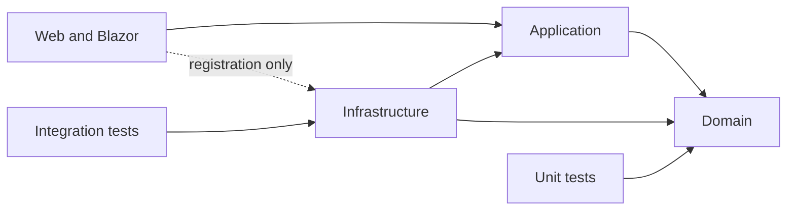

# Architecture and design decisions

BookBridge separates business decisions from database and UI details. A physical copy can have one active circulation state at a time, while a book represents a title/edition with multiple copies. That distinction allows one edition to be borrowed by several members without losing copy-level tracking.

## Dependencies

Domain holds entities, enums, `Result<T>`, and pure rules. Application defines requests, responses, use cases, and interfaces. Infrastructure implements persistence, accounts, and seed data. Web handles the request/circuit boundary, role-aware screens, notification delivery, and background scheduling.

Expected failures such as an exhausted borrowing limit return an unsuccessful result with a readable explanation. Unexpected infrastructure failures are logged and handled at the application boundary. UI messages should not reveal raw connection strings or exception details.

## Functional programming choices

Request and response DTOs are immutable records. Fine calculation, overdue-day calculation, eligibility decisions, and queue selection are pure functions with explicit inputs. LINQ expresses ordering and projection. EF entities remain classes because they represent persistent records whose state changes inside a transaction. Functional techniques are used where they improve reasoning and testing.

## Persistence and transactions

Books, authors, copies, members, loans, borrow requests, reservations, and notifications have explicit relational mappings. Unique and filtered indexes protect ISBNs, barcodes, active loans, pending requests, active reservations, and ready holds. Overdue and deadline indexes support the background worker and reports.

Each circulation command creates an operation-scoped context. All reads and writes for that command share its transaction. Short SQLite write transactions serialize competing modifications; concurrency tokens detect stale entity updates. Retries must restart the complete operation, re-read the state, and re-evaluate the rules.

The singleton `LibraryWriteCoordinator` queues local circulation writers asynchronously before opening a SQLite transaction, avoiding many request threads blocking in SQLite's lock wait. The gate does not replace database constraints or cross-process locking. Direct and EF-wrapped busy errors receive bounded whole-transaction retries. The gate, context, and transaction are released before live notification delivery.

For example, two requests borrowing different copies for a member with one remaining loan slot must not both succeed. Checking only the copy is insufficient: the member's aggregate loan count must be checked under the same write transaction.

Microsoft recommends per-operation contexts for server-side Blazor because a circuit-scoped context can be shared by concurrent component work. [EF Core with Blazor](https://learn.microsoft.com/en-us/aspnet/core/blazor/blazor-ef-core?view=aspnetcore-8.0)

SQLite has no SQL Server-style automatically updated `rowversion`; application-managed tokens are appropriate. [EF Core concurrency](https://learn.microsoft.com/en-us/ef/core/saving/concurrency)

## Circulation invariants

- Available copies have no open loan and no ready reservation.
- Borrowed copies have one open loan.
- Reserved copies have one ready reservation and no open loan.
- A member has at most one Waiting or Ready reservation for a given book.
- Ordinary borrowing cannot bypass a waiting queue.
- Pickup is a separate operation for the member assigned to a Ready reservation.
- Returns, cancellations, and expiry operations do not create duplicate historical transitions.

Reservations are ordered by creation instant and then ID for deterministic tie-breaking. Assignment changes Waiting to Ready, attaches a specific copy, and sets a 72-hour pickup deadline. Collection changes Ready to Fulfilled and creates a loan. Cancellation or expiry immediately attempts to assign the released copy to the next waiting member.

## Borrow request review

`BorrowRequest` records a member's request for an available title. Its states are Pending, Accepted, Rejected and Cancelled. Pending requests do not change copy status. A filtered unique index permits one Pending request per member/title; closed requests remain as history.

`RequestBorrowAsync` checks the authenticated member link, availability, borrowing eligibility and conflicting reservations, then stores the request and librarian notifications. `AcceptBorrowRequestAsync` requires a librarian and rechecks the pending state, membership, loan allowance, overdue loans, availability and reservation priority. It chooses an available copy and creates the loan in the same transaction as the Accepted decision and member notification. Acceptance starts the loan immediately. No additional pickup step applies to this route.

`RejectBorrowRequestAsync` records the librarian's decision and optional reason without changing inventory. `CancelBorrowRequestAsync` permits the requesting member to withdraw a pending request. Repeated or competing decisions cannot create a second loan or overwrite a completed decision. Failed acceptance preserves the pending request and rolls back all loan changes. A pending request must be cancelled before the same member joins that title's reservation queue.

Request queries return all records to librarians and only the authenticated member's records to members. The stored request, review timestamps, reviewer, note and accepted loan link make the result inspectable after reconnecting.

## Time and money

Audit and pickup timestamps use UTC. Due dates and overdue-day calculations use the configured library timezone. An injected `TimeProvider` lets tests advance time without waiting. The due date itself has zero overdue days. Each loan stores its daily fine rate; changing the configuration does not rewrite existing loan terms. Money is stored as integer minor units to avoid floating-point rounding errors.

## Authentication and authorization

Identity supplies password handling and cookies. Librarian commands include request review, checkout, return, member/catalogue management, and pickup confirmation. Members can request available books, reserve unavailable books for themselves, cancel their own pending requests/reservations, and read their own records. User identity and membership are derived server-side from authenticated claims. A supplied member ID is never sufficient authorization.

Component visibility improves usability, but every sensitive query and command also checks authorization. Login/logout follow HTTP request handling rather than trying to alter authentication cookies from an established interactive circuit.

Interactive sessions check their security stamp and current Identity roles every five minutes. Production uses explicit administrator bootstrap, secure cookies, persistent data-protection keys, and database readiness checks; see [deployment.md](deployment.md).

## State and notifications

The scoped state container holds presentation information, notifications, and bounded cached lists for one circuit. It emits change notifications; components unsubscribe when disposed. It never replaces database validation or authorization.

Notifications are stored in the same transaction as the event. After commit, an authenticated SignalR hub targets the recipient's Identity user ID. A reconnecting client reloads persisted notifications, so a missed push does not lose the message. Deduplication keys prevent every background sweep from creating the same due-soon or overdue notification.

Live delivery has an independent bounded cancellation token. A cancelled browser request or failed push cannot turn an already committed circulation operation into a reported failure. Failed deadline transactions surface to the worker for logging and retry on a later interval.

## UI design

The catalogue uses reusable book cards and a search component. Tables share a templated `DataTable<TItem>`, status badges, and paging controls. Forms expose labels and validation messages. Confirmation dialogs protect circulation changes. The layout adapts to small screens, and the theme supports light and dark preferences. Dashboard bars have text values so the chart is understandable without relying on color.

See the [class](diagrams/classes.mmd), [database](diagrams/database.mmd), and [return sequence](diagrams/return-and-reserve.mmd) diagrams.
