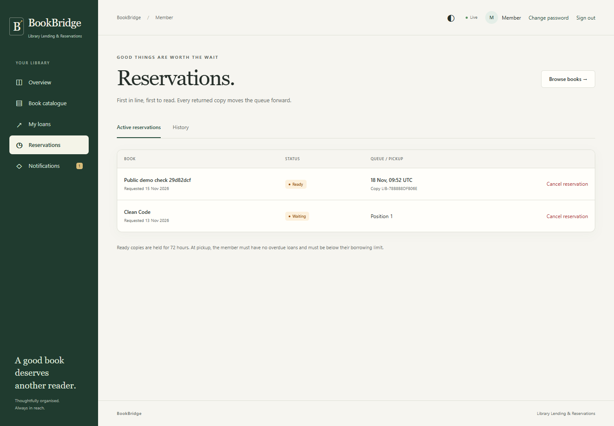

# Temporary public demo verification — 15 November 2026

The published BookBridge application was tested through its temporary Cloudflare HTTPS hostname, using a separate SQLite sample database and independently generated passwords for all 11 accounts. The app ran in Production, bound only to `127.0.0.1:5190`, trusted that loopback proxy, and persisted its data-protection keys outside the repository. The ordinary local Development instance on port 5180 used its existing separate database.

## Observed result

A Chromium browser session using installed Microsoft Edge completed **13 checks successfully**, from 09:51:45 to 09:52:34 UTC. Two isolated browser contexts represented the librarian and Jamie Chen. No browser runtime errors were reported.

1. Public HTTPS readiness returned 200/Healthy and included HSTS.
2. The old shared development password was rejected.
3. Librarian login succeeded with a Secure, HttpOnly authentication cookie.
4. Member login succeeded and the catalogue omitted librarian controls.
5. The librarian created a sample title with one copy and borrowed it to Riley James.
6. Jamie joined that title's reservation queue.
7. Returning the copy changed Jamie's reservation from Waiting to Ready in the second session **without navigation or manual refresh**.
8. The stored notification appeared and could be marked read.
9. Confirming pickup created the expected loan for Jamie.
10. That loan could be returned.
11. The notification remained after sign-out and sign-in.
12. The librarian downloaded an overdue CSV containing the seeded overdue record.
13. Both `/_blazor` and `/hubs/notifications` used WebSockets, with no page errors.

The added verification title and its returned loan history remain in the isolated demo database. The original Clean Code queue and Pride and Prejudice copies were not used by this check, preserving the defense runbook's starting scenario. The generated credentials and changing public hostname are held in a private local access file outside Git.

## Initializer verification

The new offline DemoTool built without warnings or errors. It verified 11 accounts, 10 members, 30 books, 60 copies, 17 loans, and two reservations before publishing credentials. Independent verification of persisted Identity hashes confirmed all 11 distinct generated passwords work and the old development password fails for every account. Existing database/credential destinations, repository paths, and relative paths were refused without changing existing files.

## Scope

These are browser checks through the public hostname from the host computer, not an independent remote-device test or a public load test. The temporary tunnel has no uptime guarantee and depends on the computer, server, internet connection, and tunnel remaining running. The normal development server on port 5180 is a separate fallback dataset; the Production HTTP origin on port 5190 is tunnel-only.

See [temporary demo setup](../temporary-demo.md) and [defense rehearsal](../defense-rehearsal.md). Cloudflare documents the temporary URL lifetime and limitations in its [Quick Tunnels guide](https://developers.cloudflare.com/tunnel/get-started/quick-tunnels/).
